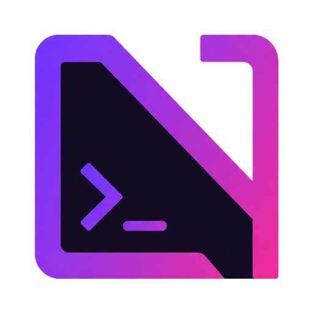

<p align="center">
  <a href="https://normahub.cc">
    
  </a>
</p>

# NormaHub MCP Server

[](https://github.com/normahubcc/mcp-server-normahub/releases)
[](https://nodejs.org)
[](LICENSE)
[](https://modelcontextprotocol.io)

Сервер [Model Context Protocol (MCP)](https://modelcontextprotocol.io) для API [NormaHub](https://normahub.cc).

Предоставляет инструменты (Tools), ресурсы (Resources) и шаблоны промптов (Prompts) для подключения моделей (DeepSeek, Claude, GPT, SeeDance Video) к **Claude Desktop**, **Cursor**, **Windsurf** и другим MCP-клиентам.

Поддерживает два вида транспорта:
- **Stdio** — локальный запуск через `npx` в IDE и десктопных клиентах.
- **SSE (Server-Sent Events)** — сетевой HTTP-транспорт для Docker, Kubernetes и удаленных серверов.

---

## Архитектура сервера

```
┌────────────────────────────────────────────────────────┐
│                  NormaHub MCP Server                   │
└───────────────────────────┬────────────────────────────┘
                            │
     ┌──────────────────────┼──────────────────────┐
     ▼                      ▼                      ▼
  TOOLS                  RESOURCES              PROMPTS
  • normahub_prompt_model• normahub://models    • review_code
  • normahub_image_to_video • normahub://status • direct_video_scene
  • normahub_generate_video                     • cost_optimize_route
  • normahub_generate_image
  • normahub_list_models
```

---

## Возможности

### 1. Tools (Инструменты)

| Инструмент | Описание | Основные параметры |
|---|---|---|
| `normahub_prompt_model` | Вызов LLM (диалоги и история сообщений) | `model`, `prompt`, `messages`, `system`, `temperature` |
| `normahub_image_to_video` | Генерация видео из статичного изображения (I2V) через SeeDance | `image_url` (URL или data URI), `prompt`, `model` |
| `normahub_generate_video` | Генерация видео из текста (T2V) через SeeDance / Grok Video | `prompt`, `model`, `duration`, `aspect_ratio` |
| `normahub_generate_image` | Генерация изображений | `prompt`, `model` |
| `normahub_list_models` | Список подключенных моделей и тарифов | — |

### 2. Resources (Ресурсы)

- **`normahub://models`** — структурированный каталог поддерживаемых моделей, контекстных окон, capabilities и тарифов (JSON и Markdown).
- **`normahub://status`** — статус шлюза, latency ping и список активных маршрутов.

### 3. Prompts (Шаблоны)

- **`review_code`** — шаблон для код-ревью (архитектура, безопасность, производительность, diff).
- **`direct_video_scene`** — шаблон для формирования сценария генерации видео (оптика, свет, физика камеры) под SeeDance.
- **`cost_optimize_route`** — подбор наиболее экономичной модели под задачу.

---

## Быстрый старт

### Claude Desktop (Stdio)

Добавьте сервер в конфигурационный файл Claude Desktop:
- **macOS:** `~/Library/Application Support/Claude/claude_desktop_config.json`
- **Linux:** `~/.config/Claude/claude_desktop_config.json`
- **Windows:** `%APPDATA%\Claude\claude_desktop_config.json`

```json
{
  "mcpServers": {
    "normahub": {
      "command": "npx",
      "args": ["-y", "@normahub/mcp-server"],
      "env": {
        "NORMAHUB_API_KEY": "nr_hub_..."
      }
    }
  }
}
```

---

### Cursor IDE

В настройках **Settings > Features > MCP > Add New MCP Server**:

1. **Name:** `normahub`
2. **Type:** `command`
3. **Command:** `npx -y @normahub/mcp-server`
4. **Environment Variables:** `NORMAHUB_API_KEY=nr_hub_...`

---

## Сетевой запуск (SSE Transport)

Для совместного использования командой или работы в контейнерах:

### Локальный запуск SSE:

```bash
git clone https://github.com/normahubcc/mcp-server-normahub.git
cd mcp-server-normahub
npm install
npm run build

export NORMAHUB_API_KEY="nr_hub_..."
npm run start:sse
```

Сервер будет доступен на порту 3001:
- SSE поток: `http://localhost:3001/sse`
- POST сообщений: `http://localhost:3001/messages`
- Health check: `http://localhost:3001/health`

### Запуск в Docker:

```bash
docker build -t normahub-mcp-server .
docker run -d \
  -p 3001:3001 \
  -e NORMAHUB_API_KEY="nr_hub_..." \
  --name normahub-mcp \
  normahub-mcp-server
```

---

## Отладка через MCP Inspector

```bash
npm run inspect
```

Команда запустит локальный веб-интерфейс MCP Inspector для интерактивного тестирования вызовов инструментов и чтения ресурсов.

---

## Лицензия

MIT License. См. [LICENSE](LICENSE).
